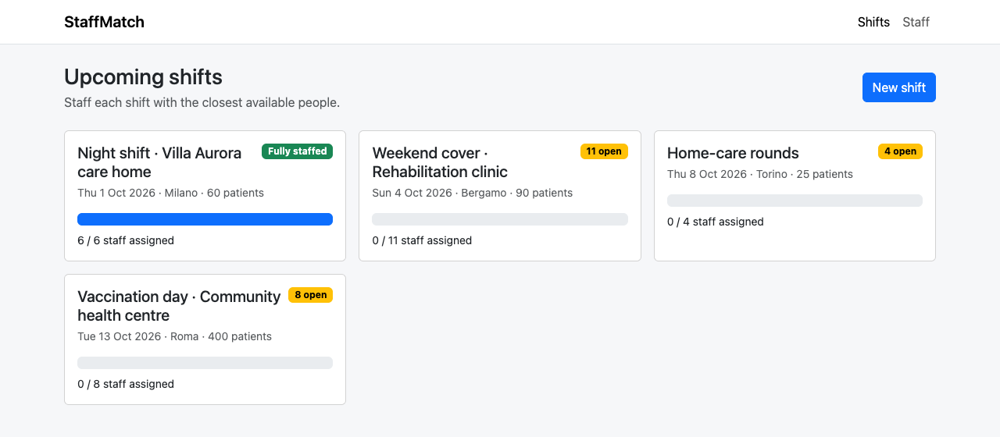
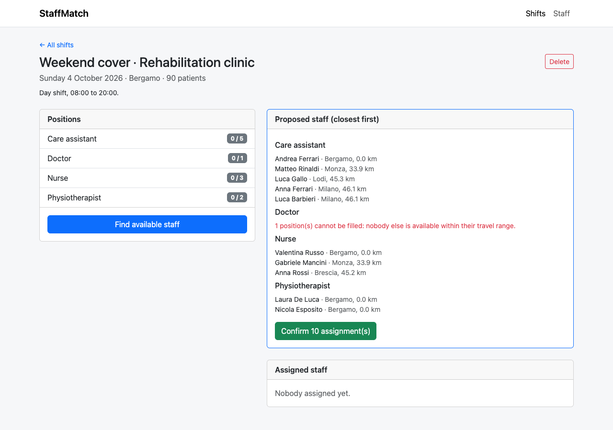
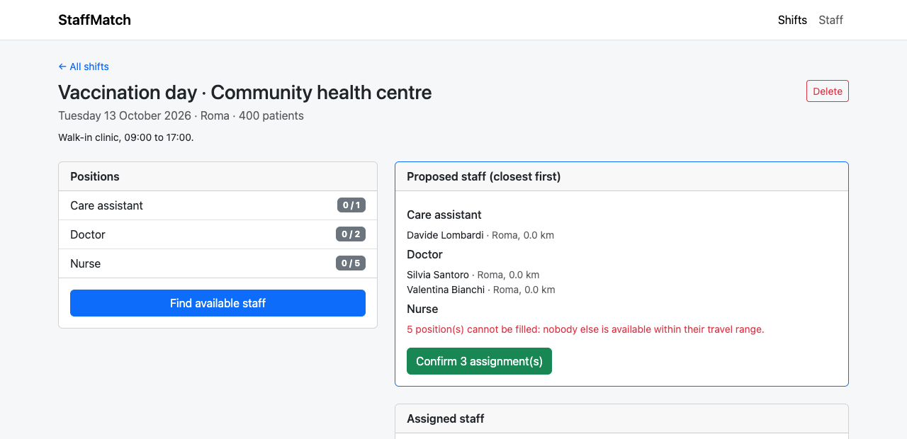
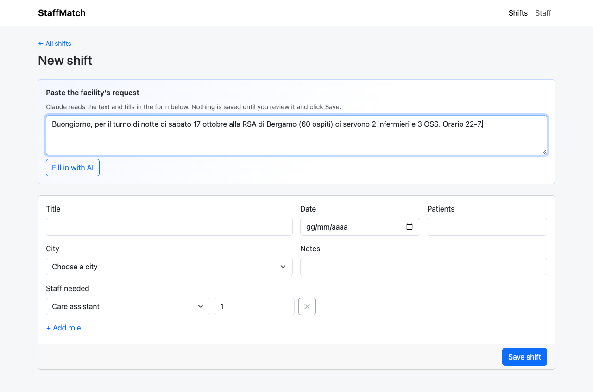
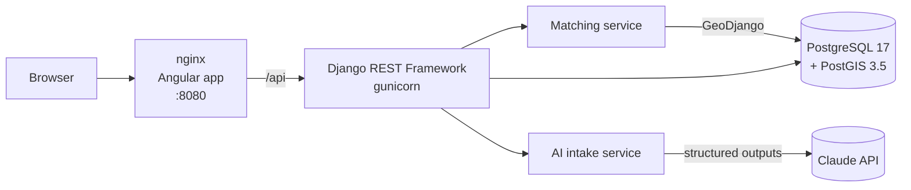
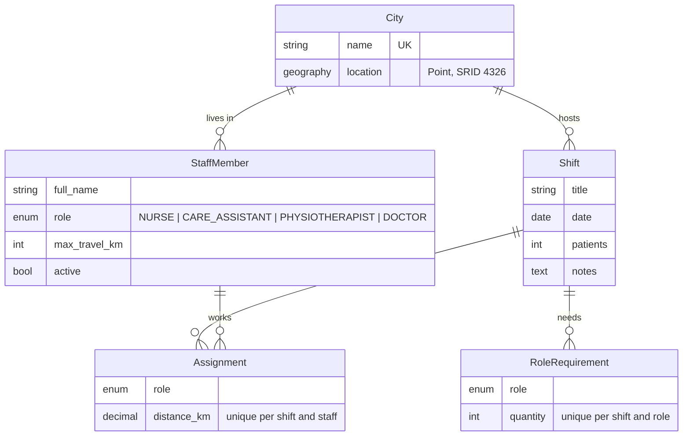

# StaffMatch · Shift staffing by distance

[](https://github.com/michele872/staffmatch/actions/workflows/ci.yml)


A healthcare staffing agency has a pool of nurses, care assistants, physiotherapists and doctors spread across Italy. Nursing homes, clinics and home-care services ask it to cover work shifts. **StaffMatch proposes the closest available professionals for every open position**, respecting how far each person is willing to travel and never booking anyone on two shifts on the same day.

Requests from the facilities usually arrive as free text, so the shift form can also be **filled in from the facility's message with the Claude API**: the draft is always reviewed by a person before it is saved.

| Shifts | Staffing proposal |
|---|---|
|  |  |
| **When there are not enough people** | **AI-assisted shift intake** |
|  |  |

---

## Features

- **Distance-based matching with PostGIS**: candidates are ranked by real distance on the Earth's surface, closest first
- **Personal travel limits**: each staff member has a maximum travel distance, and the matching respects it
- **No double bookings**: people already assigned to any shift on the same day are excluded, so everyone gets their rest
- **Preview, then confirm**: the proposal is shown first; nothing is saved until the user confirms
- **Honest shortages**: positions that cannot be filled are reported, instead of stretching the rules
- **AI-assisted intake**: paste a facility's message and Claude fills in title, date, city, number of patients, roles and notes
- **One command to run**: database, API and web app start together, with demo data loaded automatically

## How the matching works

The rules live in one service, [`staffing/services/matching.py`](backend/staffing/services/matching.py), separate from the API, and each rule has its own test.

A staff member is a **candidate** for a role at a shift when they:

1. have that role and are active;
2. are not assigned to **any** shift on the same date;
3. live within **their own** `max_travel_km` from the shift city.

The whole filter runs as a single database query. PostGIS computes the distance between geography points in metres, so condition 3 is a SQL comparison with each row's own limit:

```python
StaffMember.objects.filter(active=True, role=role)
    .exclude(assignments__shift__date=shift.date)
    .annotate(distance=Distance("city__location", shift.city.location))
    .filter(distance__lte=F("max_travel_km") * 1000)
    .order_by("distance", "full_name")
```

For each position the service takes the closest candidates up to the quantity still missing. Confirming saves the assignments in one transaction and locks the shift row, so two users confirming at the same time cannot overbook it. Running the assignment again only fills what is still open.

> Locations are stored per city, so people who live in the same city as the shift are 0 km away. Street-level addresses would only change the input data, not the algorithm.

## AI-assisted shift intake

[`staffing/services/ai_intake.py`](backend/staffing/services/ai_intake.py) sends the facility's message to the Claude API together with today's date and the list of known cities. The answer is constrained by **structured outputs** to a Pydantic model (`ShiftDraft`), so the backend always gets valid JSON with the expected fields.

Some design choices:

- **The user stays in control.** The endpoint returns a draft and never writes to the database. The form shows the draft and lists what could not be found ("Not found in the request: date").
- **Output is not trusted blindly.** The city must be one of the known cities, otherwise it is dropped. Roles are limited to an enum in the schema.
- **Missing beats invented.** The prompt asks for `null` when the message is unclear, instead of a guess.
- **Graceful failure.** Network errors, rate limits and refusals become clear messages (HTTP 502), and a server-side fallback model is enabled for refused requests.
- **Optional.** Without an API key the endpoint returns 503 and the frontend hides the AI panel. Everything else works normally.

The AI code is covered by tests that use a fake client, so the test suite needs no API key and makes no network calls.

---

## Architecture



nginx serves the compiled Angular app and proxies `/api` to Django. The browser therefore talks to a single origin, and no CORS configuration is needed.

## Tech stack

| Layer | Technology |
|---|---|
| Frontend | Angular 22 (standalone components, signals, typed reactive forms, lazy-loaded routes), Bootstrap 5 |
| Backend | Django 6.1, Django REST Framework 3.18, GeoDjango, gunicorn |
| Database | PostgreSQL 17 + PostGIS 3.5 |
| AI | Claude API through the official `anthropic` Python SDK, structured outputs with Pydantic |
| Tests | Django test runner against a real PostGIS database; Vitest for Angular |
| Infrastructure | Docker Compose, multi-stage frontend image, GitHub Actions CI |

---

## Getting started

**Requirements:** Docker with Docker Compose v2. Port `8080` must be free.

```bash
git clone https://github.com/michele872/staffmatch.git
cd staffmatch
docker compose up --build
```

Then open **http://localhost:8080**. The first start migrates the database and loads demo data: 18 Italian cities, 60 staff members and 4 upcoming shifts, one of them already fully staffed.

> **Apple Silicon:** the official PostGIS image is published for amd64 only, so Docker runs it through emulation. It works, but the first start is a bit slower.

### Enable the AI intake (optional)

Create a `.env` file next to `docker-compose.yml` with your [Anthropic API key](https://console.anthropic.com), then restart:

```bash
cp .env.example .env
# edit .env and set ANTHROPIC_API_KEY=...
docker compose up -d
```

The default model is `claude-opus-5-5`; set `ANTHROPIC_MODEL` to use a different one.

### Local development without Docker for the frontend

```bash
# backend (needs GDAL and a PostGIS database; see backend/Dockerfile)
cd backend && pip install -r requirements.txt
python manage.py migrate && python manage.py seed_demo && python manage.py runserver

# frontend, with /api proxied to localhost:8000
cd frontend && npm install && npm start
```

---

## Tests

```bash
# Backend: 22 tests, run against PostGIS
docker compose run --rm --entrypoint "python manage.py test" backend

# Frontend: component tests with Vitest
cd frontend && npx ng test --watch=false
```

GitHub Actions runs both suites on every push, with PostGIS as a service container.

## API reference

Base URL: `http://localhost:8080/api`

| Method | Endpoint | Description |
|---|---|---|
| `GET` | `/shifts/` | Shifts with required and assigned staff totals |
| `POST` | `/shifts/` | Create a shift with its role requirements |
| `GET` | `/shifts/{id}/` | Shift detail with requirements and assignments |
| `DELETE` | `/shifts/{id}/` | Delete a shift |
| `GET` | `/shifts/{id}/plan/` | **Preview** the closest available people for each open position |
| `POST` | `/shifts/{id}/assign/` | **Confirm**: save the proposed assignments |
| `DELETE` | `/assignments/{id}/` | Remove one assignment and free the position |
| `POST` | `/shifts/draft-from-text/` | Turn a free-text request into a shift draft (AI, not saved) |
| `GET` | `/staff/?role=&city=` | Staff pool, filterable by role and city |
| `GET` | `/cities/` | Known cities with coordinates |
| `GET` | `/meta/` | Feature flags (`ai_intake_enabled`) |

Example: `GET /shifts/4/plan/` for a vaccination day in Rome, where the staff pool is mostly in the north:

```json
[
  {
    "role": "CARE_ASSISTANT", "required": 1, "already_assigned": 0, "missing": 0,
    "candidates": [
      { "staff": 50, "staff_name": "Davide Lombardi", "staff_city": "Roma", "distance_km": "0.0" }
    ]
  },
  {
    "role": "DOCTOR", "required": 2, "already_assigned": 0, "missing": 0,
    "candidates": [
      { "staff": 53, "staff_name": "Silvia Santoro", "staff_city": "Roma", "distance_km": "0.0" },
      { "staff": 34, "staff_name": "Valentina Bianchi", "staff_city": "Roma", "distance_km": "0.0" }
    ]
  },
  { "role": "NURSE", "required": 5, "already_assigned": 0, "missing": 5, "candidates": [] }
]
```

## Data model



## Project structure

```
staffmatch/
├── docker-compose.yml              # db (PostGIS) + backend + web
├── .github/workflows/ci.yml        # backend and frontend tests on every push
├── backend/
│   ├── config/                     # Django settings (environment-driven) and URLs
│   └── staffing/
│       ├── models.py
│       ├── services/
│       │   ├── matching.py         # candidate search, plan, assignment
│       │   └── ai_intake.py        # Claude structured outputs → ShiftDraft
│       ├── serializers.py, views.py, urls.py
│       ├── management/commands/seed_demo.py
│       └── tests/                  # matching, API and AI intake tests
└── frontend/
    ├── Dockerfile, nginx.conf      # multi-stage build, SPA + /api proxy
    └── src/app/
        ├── core/                   # typed API client and models
        ├── shifts/                 # list, detail (plan + confirm), form (AI fill-in)
        └── staff/                  # staff pool with filters
```

## Possible next steps

- Authentication and per-facility data (Django auth + JWT)
- Street-level addresses with geocoding instead of city centres
- Day, night and on-call time slots, and weekly working-hour limits
- Qualifications and certificates per person (e.g. intensive care, paediatrics)
- Notifying assigned staff by email or push
- A map view of the shift and the proposed people

---

## Author

**Michele Magurno**, Full Stack Developer
[LinkedIn](https://www.linkedin.com/in/michele-magurno-583563106) · [GitHub](https://github.com/michele872)
